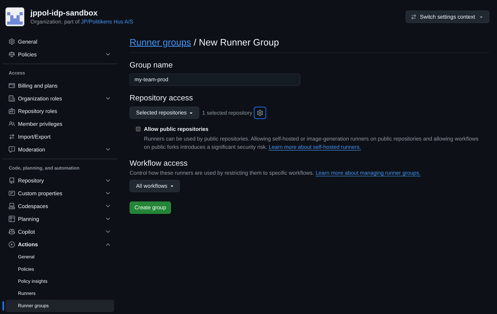
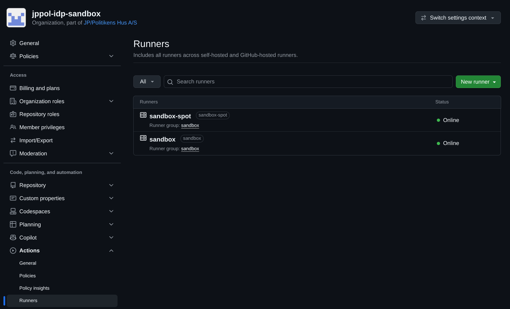
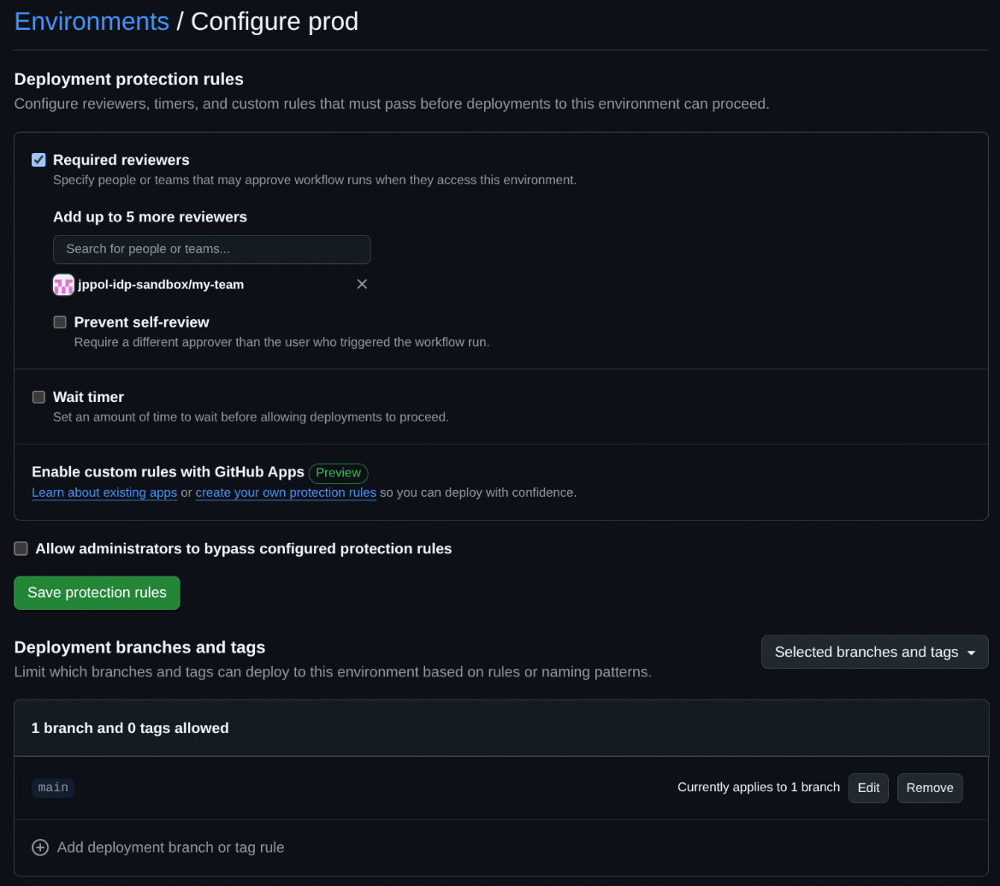
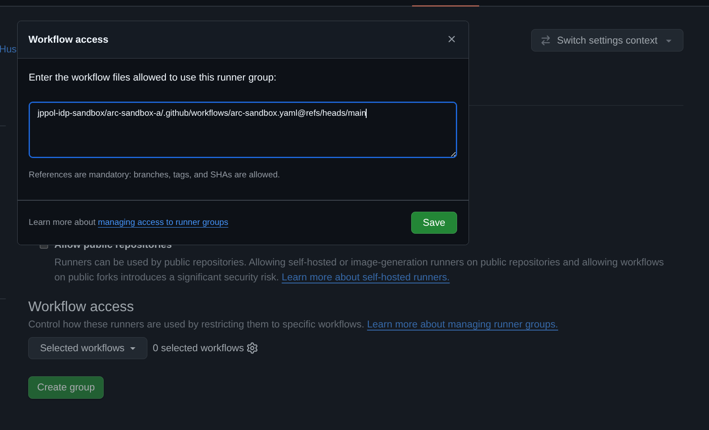
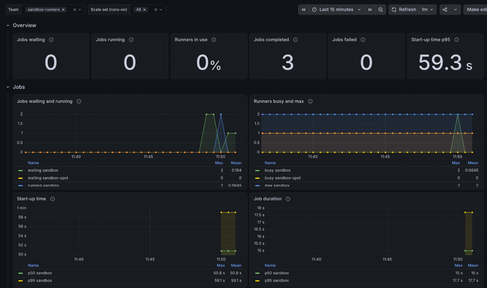

# Self-hosted GitHub Actions runners
{: .no_toc }

IDP can run GitHub Actions runners for your team inside the IDP cluster your team already uses. A workflow job on one of these runners can reach things that GitHub-hosted runners cannot: services in your team's namespaces and internal endpoints such as a Kafka cluster in your AWS account.

IDP runs and maintains the runners. Your team decides which repositories may use them and guards production jobs on the GitHub side.

## What this first version supports

This is the first version of self-hosted runners on IDP. It covers one need well: **a workflow step that needs network access to something only reachable from inside the IDP cluster.**

Supported now:

- Reaching services in your team's namespaces, e.g. updating schemas in a schema registry or running smoke tests against an internal API.
- Reaching addresses behind the cluster's network, e.g. a Kafka cluster in your team's own AWS account.
- AWS access to **your team's own AWS account**, through GitHub OpenID Connect (OIDC).
- Runners on any IDP cluster, in two sizes, on regular or spot capacity.

Not supported yet:

- **AWS access to resources IDP manages for you** (S3 buckets, DynamoDB tables, secrets and databases created through IDP). The one exception is S3, where the existing [GitHub Actions access for buckets](s3-bucket.html#github-actions-access) also works from a self-hosted runner, with the limits described there.
- **Docker and root** in the job. See [Limitations](#limitations).
- **Deploying to the cluster** from a job. Deploys go through ArgoCD as usual.

More may come in later versions, based on what teams need. If your use case is not covered, tell the IDP team in your team's onboarding channel on Slack; that is what decides what comes next.

If a job only needs the internet (building, testing, pushing images, calling public APIs), keep it on GitHub-hosted runners. They start faster, come with more tools preinstalled and can run Docker. Most workflows combine the two: build on GitHub-hosted runners, and run only the step that needs network access on a self-hosted runner. See [Step 4](#step-4-use-the-runners-in-a-workflow).

## Table of contents
{: .no_toc }

- TOC
{:toc}

## What you get

- **One runner per job.** Every job gets a fresh runner that is removed when the job ends. Nothing is left over between jobs, and one job cannot see another job's files.
- **Runner names you use in `runs-on`.** Each runner type (a *scale set*) has a name, such as `my-team-prod`. A job selects it with `runs-on: my-team-prod`. See [Names](#names).
- **One scale set per environment.** Dev, test, staging and production each get their own scale set, so each environment can only reach its own targets.
- **A fixed network allow-list.** Runners reach the internet and the targets IDP has opened for that environment, nothing else. See [Network access](#network-access).
- **No AWS credentials from IDP.** Jobs that need AWS get them through GitHub's OpenID Connect (OIDC) integration. See [AWS access from a job](#aws-access-from-a-job).

### Names

All names follow the namespace of the environment the runners serve. For an environment whose apps run in the namespace `my-team-prod`:

| What | Name |
|------|------|
| Runner group in GitHub | `my-team-prod` |
| Scale set, used in `runs-on` | `my-team-prod` |
| Second scale set, if the environment needs both sizes | `my-team-prod-build` (the `large` one) |
| Namespace the runners run in | `my-team-prod-runners` |

The runners run on the IDP cluster where that namespace is, so you do not need to name a cluster.

### Sizes

Each scale set has one size:

| Size | CPU (guaranteed) | Memory | Disk |
|------|------------------|--------|------|
| `small` | 0.2 CPU | 1 GiB, up to 2 GiB | shared with the node |
| `large` | 2 CPU | 4 GiB | 10 GiB, up to 20 GiB |

The CPU figure is what the job is guaranteed. A job can use more when the node has spare CPU, so most jobs run faster than the number suggests. A job that goes over its memory limit is stopped.

If an environment needs both sizes, it gets two scale sets in the same runner group: `my-team-prod` (small) and `my-team-prod-build` (large). If neither size fits your job, tell the IDP team; more sizes can be added.

### Start-up time

A job usually starts within a minute of being queued. When no node is free, a new node is started first, which takes about 50 to 60 seconds. GitHub shows the job as *queued* during this time. The [dashboard](#monitoring-your-runners) shows the start-up time per scale set.

Each scale set also has a maximum number of runners that run at the same time. Jobs above that limit wait in the queue until a runner is free.

### Spot capacity

A scale set can run on spot capacity, which is cheaper but can be interrupted. An interrupted job is killed, and GitHub does not retry it. Use spot only for jobs that are safe to re-run, such as builds and tests, and never for deploys or migrations. Scale sets run on regular (on-demand) capacity unless you ask for spot.

### Limitations

- **No Docker.** Jobs cannot build images with `docker build`, run `container:` jobs or use `services:`.
- **No root.** The job runs as an unprivileged user, so `sudo` and `apt-get install` do not work.
- **No access to the Kubernetes API.** Runners cannot deploy to the cluster. Deploys go through ArgoCD as usual.

The runner image is GitHub's [actions-runner](https://github.com/actions/runner/pkgs/container/actions-runner) image on Ubuntu 24.04, not the larger image GitHub-hosted runners use. It includes `git`, `curl`, `jq`, `unzip`, `tar`, `python3` and `ssh`. Language runtimes come from the `setup-*` actions (for example `actions/setup-node` or `actions/setup-python`), which work without root. Other tools, such as the AWS CLI, can be downloaded into the workspace.

These limits rarely matter in practice, because the job on the self-hosted runner only has to do the part that needs network access. Everything else, including image builds, runs on GitHub-hosted runners in the same workflow. See [Step 4](#step-4-use-the-runners-in-a-workflow).

## Getting runners for your team

### Step 1: create a runner group per environment

A *runner group* decides which repositories can use a scale set. Create one group per environment, named after the environment's namespace (see [Names](#names)). This needs an owner of your GitHub organisation. If your repositories live in an organisation shared with other teams, such as `Jyllands-Posten` or `Politiken`, ask that organisation's owners to create the groups.

1. Open your organisation's **Settings → Actions → Runner groups** and click **New runner group**.
2. Enter the group name: the environment's namespace, e.g. `my-team-prod`.
3. Under **Repository access**, choose **Selected repositories** and pick only the repositories that may use these runners.
4. Leave **Allow public repositories** off.
5. Leave **Workflow access** on **All workflows** for now. You can limit it later, see [Protecting production jobs](#protecting-production-jobs).
6. Click **Create group**.



The group must exist before IDP adds your scale set, because the runners register into it. Create the groups for all the environments you need before you go on to Step 2. You can add or remove repositories in a group at any time, without involving IDP.

Do not use **New runner → New self-hosted runner** on the **Runners** page. That registers a runner on a machine of your own; IDP's runners register themselves.

### Step 2: ask the IDP team

Copy the request below, fill it in with one block per environment, and post it to the IDP team in your team's onboarding channel on Slack. With everything in one message, we can set up the runners without further questions.

```text
Self-hosted runners

GitHub organisation: https://github.com/my-org
Runner groups created: my-team-staging, my-team-prod

Environment: my-team-prod
  Size: small                     (small, large or both, see "Sizes")
  Spot: no                        (yes only for jobs that are safe to re-run)
  Max runners at the same time: 4
  Targets:
    - service my-schema-registry in namespace my-team-prod, port 8081
    - 10.20.30.0/24, port 9098: Kafka (MSK) in our AWS account

Environment: my-team-staging
  ...

We accept the risk of internal targets described in the guide.
```

See [Asking for a target](#asking-for-a-target) for what a target needs, and [Internal targets and risk](#internal-targets-and-risk) for what the last line means. Leave out **Targets** if the environment only needs the internet.

We install the IDP GitHub App, `jppol-idp-arc`, on your organisation and add the scale sets. Only IDP can install the app: it is an internal app of the JP/Politikens Hus GitHub enterprise and needs no permissions beyond managing self-hosted runners. It shows under your organisation's **Settings → GitHub Apps**. Do not remove it, because the runners stop working without it.

We reply in the channel when the runners are running.

### Step 3: check the connection

The scale sets now show as **Online** under your organisation's **Settings → Actions → Runners**, in the runner group you created. The screenshot below is from IDP's test organisation, where the scale sets are called `sandbox` and `sandbox-spot`; yours are named after your namespaces, e.g. `my-team-prod`.



Before you build the real workflow, check that the runners reach your targets. Add this workflow to one of the repositories in the runner group, on the default branch, with one step per target:


```yaml
# .github/workflows/runner-check.yaml
name: Runner check
on: workflow_dispatch

jobs:
  check:
    runs-on: my-team-prod
    timeout-minutes: 5
    steps:
      - name: Schema registry (service in the cluster)
        run: curl -sS --max-time 10 -o /dev/null -w '%{http_code}\n' http://my-schema-registry.my-team-prod.svc.cluster.local:8081/
      - name: Kafka (address outside the cluster)
        run: timeout 10 bash -c '</dev/tcp/10.20.30.40/9098' && echo "port 9098 is open"
```


Run it from the repository's **Actions** tab with **Run workflow**. A step that prints an HTTP status (even `401` or `404`) or `port 9098 is open` reached its target. A step that fails after 10 seconds did not; see [How a blocked connection looks](#how-a-blocked-connection-looks). A step that fails at once with `Could not resolve host` has a wrong service or namespace name.

### Step 4: use the runners in a workflow

Select the scale set with `runs-on`.

Each job in a workflow has its own `runs-on`, so split the workflow: do the build on a GitHub-hosted runner, and run only the part that needs network access on your self-hosted runner. `needs:` makes the second job wait for the first, and an artifact carries the files across:


```yaml
jobs:
  build:
    runs-on: ubuntu-latest            # GitHub-hosted: Docker, root and the full tool set
    steps:
      - uses: actions/checkout@v4
      - run: make schemas
      - uses: actions/upload-artifact@v4
        with:
          name: schemas
          path: build/schemas/

  update-schemas:
    needs: build                      # starts only when build has succeeded
    runs-on: my-team-prod             # self-hosted: only the step that needs the network
    environment: prod
    timeout-minutes: 15
    steps:
      - uses: actions/download-artifact@v4
        with:
          name: schemas
      - run: ./update-schemas.sh
```


- Artifacts go through GitHub over the internet, which runners can reach. For small values such as an image tag, use job outputs (`needs.build.outputs.<name>`) instead.
- Put the environment and its protection on the self-hosted job only. The build job can run on any branch.
- The split costs a little time for the artifact transfer and the extra runner start, usually under a minute for small files.

Always set `timeout-minutes` on the self-hosted job. A job waiting on a blocked connection otherwise hangs until GitHub's six-hour limit.

## Protecting production jobs

Anyone who can push a workflow to a repository in the runner group can run code on the runners for that environment. For a production scale set, use the controls GitHub gives you:

- **Environments with required reviewers.** Put production jobs behind a GitHub environment (`environment: prod` above) with required reviewers and a deployment branch rule that allows only your main branch. Environments belong to a repository, so set one up in each repository that runs production jobs:

  1. Open the repository's **Settings → Environments** and click **New environment**. Name it `prod`, the name the workflow uses in `environment:`.
  2. Tick **Required reviewers** and add the people or teams who approve production jobs.
  3. Turn off **Allow administrators to bypass configured protection rules**, so the review cannot be skipped.
  4. Under **Deployment branches and tags**, choose **Selected branches and tags** and add `main`.
  5. Click **Save protection rules**.

  

- **Selected workflows on the runner group.** On the runner group, set **Workflow access** to **Selected workflows** and click the gear icon next to it. Enter the workflow files that may use the group, each with a branch, tag or commit, e.g. `my-org/my-repo/.github/workflows/update-schemas.yaml@refs/heads/main`. Then no other workflow, and no pull request branch, can use the production runners. The screenshot below is from IDP's test organisation.

  

- **AWS roles bound to the environment.** Let your production AWS role trust only the `prod` environment (see below), so a job outside that environment gets no AWS access at all.

## AWS access from a job

IDP gives runners no AWS credentials. A job that needs AWS assumes a role in your AWS account through GitHub OIDC.

If your team has its own AWS account, create the GitHub OIDC identity provider there once (`token.actions.githubusercontent.com`, audience `sts.amazonaws.com`) and one role per environment. Limit the trust policy to the repository and environment:

```json
{
  "Version": "2012-10-17",
  "Statement": [
    {
      "Effect": "Allow",
      "Principal": {
        "Federated": "arn:aws:iam::111122223333:oidc-provider/token.actions.githubusercontent.com"
      },
      "Action": "sts:AssumeRoleWithWebIdentity",
      "Condition": {
        "StringEquals": {
          "token.actions.githubusercontent.com:aud": "sts.amazonaws.com",
          "token.actions.githubusercontent.com:sub": "repo:my-org/my-repo:environment:prod"
        }
      }
    }
  ]
}
```

In the workflow, give the job `id-token: write` and assume the role:


```yaml
jobs:
  update-schemas:
    runs-on: my-team-prod
    environment: prod
    permissions:
      id-token: write
      contents: read
    steps:
      - uses: aws-actions/configure-aws-credentials@v4  # example version, see the action's releases for the latest
        with:
          role-to-assume: arn:aws:iam::111122223333:role/my-team-prod-github
          aws-region: eu-west-1
```


AWS access to resources IDP manages for you is [not supported yet](#what-this-first-version-supports). For S3 buckets, use the existing [GitHub Actions access for buckets](s3-bucket.html#github-actions-access). That role trusts only workflows on the `main` branch and does not trust jobs that use `environment:`, so a job that needs it cannot also use an environment for its protection; limit the runner group to [selected workflows](#protecting-production-jobs) instead.

## Network access

Runners in a scale set can reach:

- the internet, including GitHub, public container registries and AWS APIs
- DNS in the cluster
- the targets IDP has opened for that environment

Everything else is blocked: other namespaces in the cluster, the Kubernetes API, the node's metadata service and other internal addresses.

### Asking for a target

List the targets per environment in the [request](#step-2-ask-the-idp-team):

- **A service in the cluster:** the service name, its namespace and the port, e.g. `service my-schema-registry in namespace my-team-prod, port 8081`. A job calls it by its full name, `my-schema-registry.my-team-prod.svc.cluster.local`, because the runners run in a namespace of their own and the short name does not resolve there.
- **An address outside the cluster:** the IP range, the port and what it is, e.g. `10.20.30.0/24, port 9098: Kafka (MSK) in our AWS account`. For an AWS service such as MSK, the range is the CIDR of the subnets the service runs in, which the AWS console shows under **VPC → Subnets**. If your apps in the cluster reach the address today, the network route already exists. If they do not, ask the IDP team before you put it in the request.

For a service in the cluster, we also open the route at the receiving end, so you do not need to [ask for a namespace exception](network-access.html#asking-for-an-exception) separately.

The allow-list is per environment. A target that is shared between environments, such as one Kafka cluster used by both staging and prod, is reachable from the runners of every environment it is opened for.

### Internal targets and risk

Opening a target to a runner group means that everyone with write access to a repository in that group can reach the target from a job. If the target has no authentication of its own, that is the same access your running app has: a job could read or change what the app can.

Before we open an internal target, your team confirms in writing that it accepts this. For production targets without authentication, we recommend [limiting the runner group to selected workflows](#protecting-production-jobs). IDP can decline a target when the risk is too high, for example direct access to a production database.

### How a blocked connection looks

A blocked connection is dropped, not refused. The job sees the connection hang and then time out (`curl: (28) Connection timed out`), with no error from the target. If a job times out against an address you expected to reach, check the **Denied connections from runners** panel on the dashboard, or ask the IDP team.

## Monitoring your runners

The **GitHub runners** dashboard in your cluster's Grafana (folder **Infrastructure**) shows, per scale set:

- jobs waiting, running, completed and failed
- runners in use against the maximum
- start-up time and job duration
- denied connections from your runners, with destination and port

Pick your runners in the **Team** variable, and optionally one runner type in **Scale set (runs-on)**. Your runners run in a namespace named after your team and environment with `-runners` at the end, e.g. `my-team-prod-runners`; that is the value the **Team** variable shows and the one the alert queries below use.

The screenshot below shows the top of the dashboard for IDP's test runners, `sandbox-runners`; the denied connections are further down the page.



### Runner logs

A job's output is in GitHub, as for any other runner. The runner's own diagnostic log is in Grafana (Loki). It shows when the runner started, when it picked up the job and any errors talking to GitHub, so it helps when a job hung or failed without an explanation in GitHub.

Each runner is a pod named after the runner, which the **Set up job** step in GitHub shows as **Runner name** (e.g. `my-team-prod-runner-abc12`). In **Explore**, with the Loki data source:

```logql
{namespace="my-team-prod-runners", pod="my-team-prod-runner-abc12"}
```

Leave out `pod` to see all your runners in that environment.

The log includes your workflow's step scripts, and everyone with Grafana access on the cluster can read it, including other teams. Secrets are masked as they are in GitHub, but do not keep sensitive values in plain text in workflow files.

### Alerts

IDP is alerted when the runner platform itself fails. To be alerted about your own jobs, create alert rules in Grafana as described in [Alerting](alerting.html), with these queries:

**Jobs waiting for a runner.** Fires when jobs have been queued but not started; alert when the value stays above 0 for 10 minutes:

```promql
sum(gha_assigned_jobs{namespace="my-team-prod-runners"})
  - sum(gha_running_jobs{namespace="my-team-prod-runners"})
```

**Failed jobs.** Number of failed jobs in the last hour; alert when it is above 0, or above a threshold that suits you:

```promql
sum(increase(gha_completed_jobs_total{namespace="my-team-prod-runners", job_result="failed"}[1h]))
```

Jobs shorter than about 30 seconds may not show up in the running-jobs figures, but they are counted as completed or failed.

## Changing your setup

- **More or fewer repositories:** change the runner group yourselves, under **Settings → Actions → Runner groups**. IDP is not involved.
- **New targets, another size, spot or a higher maximum:** post the [request](#step-2-ask-the-idp-team) again with only the environment and the lines that change.
- **Another environment:** create its runner group first ([Step 1](#step-1-create-a-runner-group-per-environment)), then post the request for that environment.

## Removing runners

Ask the IDP team in your onboarding channel. We remove the scale sets first, so they disappear from GitHub, and then the runner namespace. Delete the runner groups in GitHub afterwards.

## Troubleshooting

**The job stays queued.** Check that the repository is in the runner group, that the `runs-on` name matches the scale set exactly, and that the repository is not public. If the group is limited to [selected workflows](#protecting-production-jobs), check that the workflow file and branch are in the list. If all of this is right, check **Jobs waiting** on the dashboard and ask the IDP team.

**`Could not resolve host` for a service in the cluster.** Use the full name, `<service>.<namespace>.svc.cluster.local`. The short name does not resolve from the runners' namespace.

**The job times out connecting to something.** The target is probably not on the allow-list. See [How a blocked connection looks](#how-a-blocked-connection-looks).

**`Not authorized to perform sts:AssumeRoleWithWebIdentity`.** The role's trust policy does not match the job. Check that the job has `environment:` set to the environment the trust policy names, and that the job has `id-token: write`.

**The job was killed halfway.** On a spot scale set this is an interruption; re-run the job. On a regular scale set, check whether the job ran out of memory and needs the `large` size.

For anything else, write to the IDP team in your team's onboarding channel on Slack.
