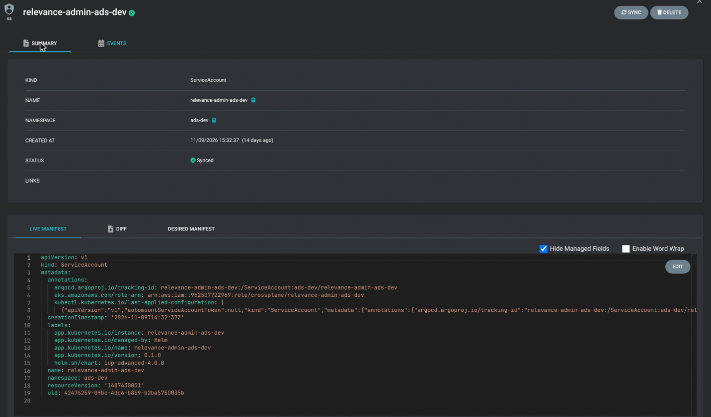

# Workload Identity for External Services
{: .no_toc }

Let your pods authenticate to services outside AWS, such as Microsoft Entra ID or Google Cloud, without storing an API key or client secret. The pod gets a short-lived token signed by AWS, and the external service is set up to trust tokens from your app's role.

---

## Table of contents
{: .no_toc }

- TOC
{:toc}

---

## How it works

1. Your pod uses its IAM Roles for Service Accounts (IRSA) role to ask AWS Security Token Service (STS) for a token. The token is a signed JSON Web Token (JWT) that says which role asked for it and which service it is meant for.
2. The pod sends the token to the external service.
3. The external service checks the signature against the public keys of the token's issuer, and checks that the role and audience in the token match what it has been set up to trust. If they do, it gives the pod access, usually by returning its own short-lived token.

There is no secret to store, rotate or leak. A token is only useful to an external service that has been set up to trust your specific role.

The external service must support OpenID Connect (OIDC) based workload identity federation with a custom issuer. Many do, for example Microsoft Entra ID (federated credentials) and Google Cloud (Workload Identity Federation). Check the documentation of the service you want to use.

## What you need

- An app deployed with `idp-advanced` and IRSA enabled, or your own chart with an IRSA role.
- The issuer URL for your cluster, see [Issuer URLs](#issuer-urls).
- Access to configure trust in the external service. For Microsoft Entra ID app registrations, this is handled by servicedesk or the owner of the app registration.

## Issuer URLs

Each cluster runs in its own AWS account and has its own issuer. Test and prod are separate, so set up trust for each environment you use.

| Cluster | Account ID | Issuer URL |
|---|---|---|
| ai-test | `058264145527` | `https://a12c2710-6dce-47a1-87e9-9afc6f1fa28b.tokens.sts.global.api.aws` |
| ai-prod | `605134432845` | `https://a19f13f3-4f6a-41ca-83ec-e2f11a8f314b.tokens.sts.global.api.aws` |
| koa-dev | `931827427725` | `https://a19877f7-27f8-4b6f-8b1b-11efcb4c3f49.tokens.sts.global.api.aws` |
| koa-prod | `151484623076` | `https://a16cbf4b-fc3c-42bf-bf48-1443fd7d17e4.tokens.sts.global.api.aws` |
| idp-shared-test | `962507722969` | `https://a1a3fd02-1278-4dbc-94d1-bbe1ed6fb291.tokens.sts.global.api.aws` |
| idp-shared-prod | `072248436309` | `https://a1d4e792-a31c-4572-8044-9bc080ff2c6c.tokens.sts.global.api.aws` |
| pup-hsk-test | `256140316312` | `https://a1c469da-ad8b-4d6c-b071-b55fac22e184.tokens.sts.global.api.aws` |
| pup-hsk-prod | `608713827792` | `https://a1bc0a17-c14e-4cf0-b1ad-e7b558c3330d.tokens.sts.global.api.aws` |

The issuer publishes its configuration at `<issuer URL>/.well-known/openid-configuration`, which is what the external service reads.

## Step 1: Allow your role to get tokens

Your IRSA role needs permission to call `sts:GetWebIdentityToken`. With `idp-advanced`, add a statement to `serviceAccount.irsa.iamPolicyStatements` in your `values.yaml`:

```yaml
serviceAccount:
  irsa:
    enabled: true
    iamPolicyStatements:
      - Effect: Allow
        Action:
          - sts:GetWebIdentityToken
        Resource:
          - "*"
        Condition:
          ForAllValues:StringEquals:
            sts:IdentityTokenAudience:
              - api://AzureADTokenExchange
          "Null":
            sts:IdentityTokenAudience: "false"
```

The `Condition` is optional but recommended. It limits the role to getting tokens for the audiences you list, so the role cannot be used to get tokens for other services. Replace `api://AzureADTokenExchange` with the audience your external service expects. The `"Null"` part makes sure a request without an audience is rejected.

If you use your own chart, add the same statement to the IAM policy of your IRSA role.

### Find your role ARN

The external service needs the Amazon Resource Name (ARN) of your role. With `idp-advanced`, the role has the same name as the app in ArgoCD: the app's folder path below the namespace folder, with `/` replaced by `-`, followed by the namespace. For an app in `apps/my-namespace/my-app/`, the role ARN is:

```
arn:aws:iam::<account-id>:role/crossplane/my-app-my-namespace
```

`<account-id>` is the AWS account of your cluster, listed in [Issuer URLs](#issuer-urls).

The easiest way to get the exact value is in ArgoCD. Open your app, click the `ServiceAccount` object and look at the annotation `eks.amazonaws.com/role-arn` in the live manifest.

The screenshot shows a real app, `relevance-admin-ads-dev` in the namespace `ads-dev` on idp-shared-test. In the examples on this page, that would be `my-app-my-namespace`.



You can also read the `AWS_ROLE_ARN` environment variable that IRSA adds to the pod spec, using the read-only `idp-ns-<namespace>` context from [Kubernetes namespace access](/how-to/kubernetes-namespace-access.html):

```bash
kubectl -n my-namespace get pods -l app.kubernetes.io/name=my-app-my-namespace \
  -o jsonpath='{.items[0].spec.containers[0].env[?(@.name=="AWS_ROLE_ARN")].value}'
```

## Step 2: Get a token in your pod

IRSA already gives your pod AWS credentials and sets the AWS region, so no extra configuration is needed. Use a current version of the AWS CLI or SDK, since older versions do not have the `GetWebIdentityToken` call.

With the AWS CLI:

```bash
aws sts get-web-identity-token \
  --audience api://AzureADTokenExchange \
  --signing-algorithm RS256 \
  --query WebIdentityToken --output text
```

With Python (boto3):

```python
import boto3

sts = boto3.client("sts")
response = sts.get_web_identity_token(
    Audience=["api://AzureADTokenExchange"],
    SigningAlgorithm="RS256",
)
token = response["WebIdentityToken"]
```

- `Audience` must match what the external service expects, and what you allowed in step 1.
- `SigningAlgorithm` is required. Use `RS256` or `ES384`, depending on what the external service supports.
- The token is valid for 5 minutes by default. Set `DurationSeconds` (60 to 3600) for a different lifetime, and get a new token before the old one expires.

Pass the token to the external service as its documentation describes, typically in a token exchange request.

## Step 3: Set up trust in the external service

The external service needs three values:

| Setting | Value |
|---|---|
| Issuer | The issuer URL for your cluster, from [Issuer URLs](#issuer-urls) |
| Subject (`sub`) | Your role ARN, from [Find your role ARN](#find-your-role-arn) |
| Audience (`aud`) | The audience you use in step 2 |

Always set up trust on the subject, not only on the issuer. Every role in the AWS account can be given permission to get tokens from the same issuer, so trusting the issuer alone would let other workloads in.

In Microsoft Entra ID, these values go into a federated credential on the app registration, using the "Other issuer" scenario.

## What the token contains

A decoded token looks like this:

```json
{
  "iss": "<issuer URL for your cluster>",
  "sub": "arn:aws:iam::<account-id>:role/crossplane/my-app-my-namespace",
  "aud": "api://AzureADTokenExchange",
  "iat": 1795422923,
  "exp": 1795423223,
  "https://sts.amazonaws.com/": {
    "aws_account": "<account-id>",
    "source_region": "eu-west-1",
    "org_id": "o-...",
    "ou_path": ["o-.../r-.../ou-.../"]
  }
}
```

`sub` is always the role ARN, the same for every pod using the role. If the external service supports conditions on extra claims, it can also check the values under `https://sts.amazonaws.com/`.

## Things to know

- **Renaming or moving the app changes the role.** The role name follows the folder path and namespace, so moving the app to another folder or namespace gives a new role ARN, and the trust in the external service must be updated.
- **One trust setup per environment.** Test and prod clusters have different issuers and different role ARNs.
- **`AccessDenied` on `GetWebIdentityToken`** means the role is missing the permission from step 1, or the audience you request is not in the list you allowed.

## Help

Write to the IDP team in your team's onboarding channel on Slack.
